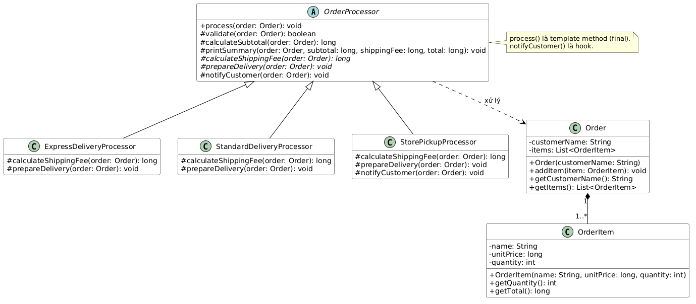
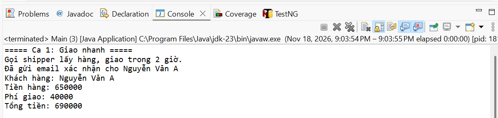
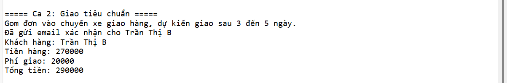
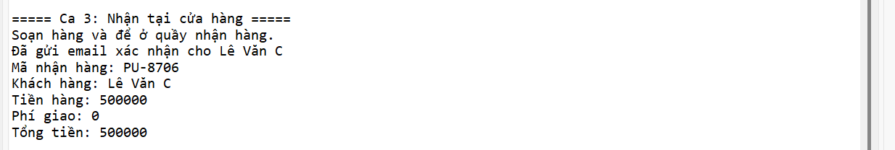
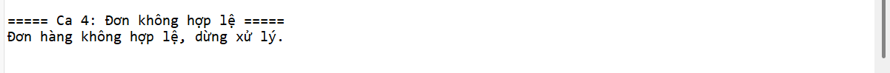
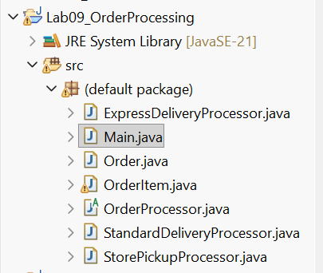

# Lab 09: Template Method - Xử lý đơn hàng theo hình thức giao

## Bài toán
Cửa hàng online xử lý đơn theo hình thức giao mà khách chọn: giao nhanh, giao tiêu chuẩn hoặc nhận tại cửa hàng. Các bước xử lý gần giống nhau, chỉ có vài bước khác theo hình thức giao.

Các bước giống nhau:
- Kiểm tra đơn hợp lệ
- Tính tiền hàng
- In tóm tắt đơn

Các bước thay đổi:
- Tính phí giao hàng
- Chuẩn bị giao hàng
- Thông báo cho khách (hook, có cách làm mặc định)

## Cách áp dụng Template Method
- `OrderProcessor` là lớp trừu tượng, phương thức `process()` là template method (final) quy định thứ tự các bước.
- `calculateShippingFee()` và `prepareDelivery()` là abstract, lớp con bắt buộc phải cài.
- `notifyCustomer()` là hook, `StorePickupProcessor` ghi đè để thêm mã nhận hàng.
- Ba lớp cụ thể: `ExpressDeliveryProcessor`, `StandardDeliveryProcessor`, `StorePickupProcessor`.

## Cấu trúc
- `src/`: mã nguồn Java (`Main`, `Order`, `OrderItem`, `OrderProcessor` và ba lớp xử lý cụ thể)
- `images/`: sơ đồ UML và ảnh kết quả

## Sơ đồ UML lớp

## Kết quả
Chương trình chạy 4 trường hợp.

Ca 1: giao nhanh

Ca 2: giao tiêu chuẩn

Ca 3: nhận tại cửa hàng

Ca 4: đơn không hợp lệ

Cây thư mục project trong Eclipse:
